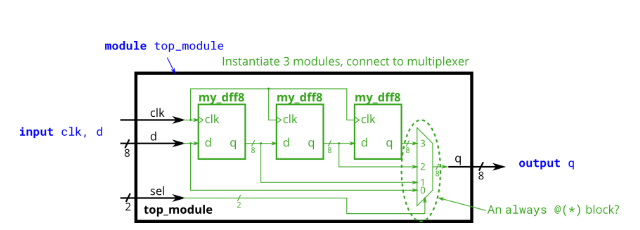
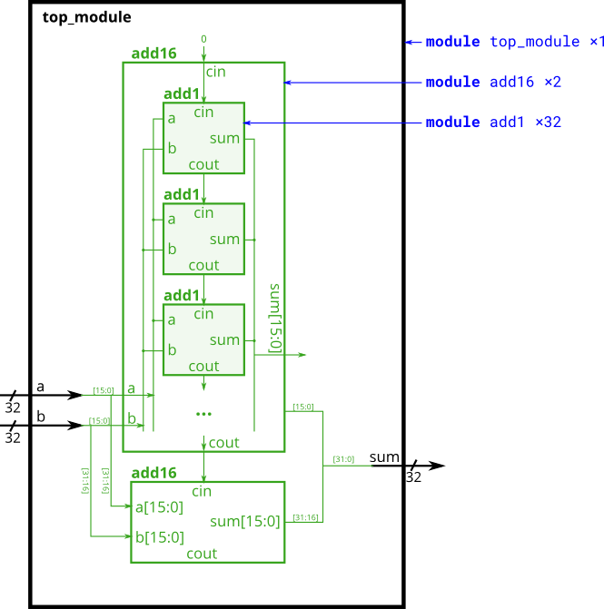

---
tags:
  - FPGA/例题
  - Verilog
date: 2023-10-27
status: draft
---

# Verilog 经典例题

## 1. 模块运算（多级 DFF 串联 + MUX 选择）

模块运算：

module my_dff8 ( input clk, input [7:0] d, output [7:0] q );

module top_module (
    input clk,
    input [7:0] d,
    input [1:0] sel,
    output [7:0] q
);

    wire [7:0] q1,q2,q3;
    my_dff8 mydff1(
        .clk(clk),
        .d(d),
        .q(q1)
    );
    my_dff8 mydff2(
        .clk(clk),
        .d(q1),
        .q(q2)
    );
    my_dff8 mydff3(
        .clk(clk),
        .d(q2),
        .q(q3)
    );

    always @(*) begin
        case (sel)
            2'b00 q=d;
            2'b01 q=q1;
            2'b10 q=q2;
            2'b11 q=q2;
        endcase
    end
endmodule

## 2. 32位加法器（16位模块级联）

module top_module(
    input [31:0] a,
    input [31:0] b,
    output [31:0] sum
);
    wire con;
    add16 lower_16 (
        .a(a[15:0]),
        .b(b[15:0]),
        .cin(0),
        .sum(sum[15:0]),
        .cout(con)
    );

    add upper_16 (
        .a(a[31:0]),
        .b(b[31:0]),
        .cin(con),
        .sum(sum[31:16]),
        .cout()
    );
end

行波进位加法器：

module top_module (
    input [31:0] a,
    input [31:0] b,
    output [31:0] sum
);//
	wire con;
    add16 lower_16 (
        .a(a[15:0]),
        .b(b[15:0]),
        .cin(1'b0),
        .sum(sum[15:0]),
        .cout(con)
    );
    add16 upper_16 (
        .a(a[31:16]),
        .b(b[31:16]),
        .cin(con),
        .sum(sum[31:16]),
        .cout()
    );
endmodule

module add1 ( input a, input b, input cin,   output sum, output cout );

// Full adder module here
	assign sum = a^b^cin;
    assign cout = (a&b) | (a&cin) | (b&cin); 
endmodule